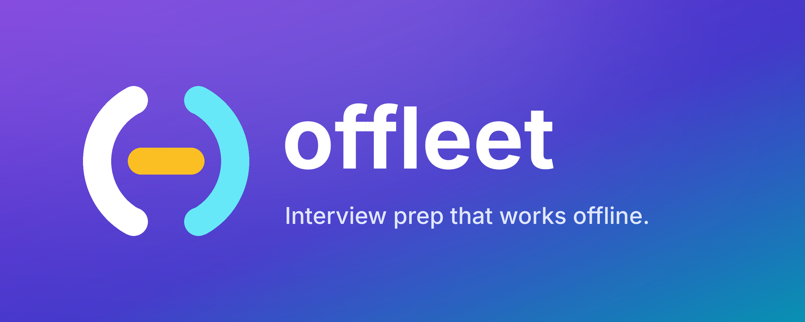

<p align="center"></p>

# Offleet

**Offline coding-interview prep for iPhone and iPad**, built for software engineers moving into **AI engineering** or
**senior** roles. Every problem comes with an animated, narrated walkthrough. There's also an audiobook mode,
bite-sized spoken reviewers and career roadmaps. Nothing needs a network connection.

## What's inside

| | |
|---|---|
| **229 problems** | 181 algorithm problems, 9 AI-engineering coding problems, 7 senior design-coding problems, 17 Spring Boot and 15 Angular exercises |
| **Java + Python** | Every algorithm solution in both languages, verified against tests by the build. Sliding Window / Two Pointers first wherever possible (27 + 51 problems), short and O(n)/O(1) where possible |
| **Animated tutorials** | 3,125 narrated frames: arrays with pointers and windows, maps, stacks, grids, linked lists, trees, graphs, DP tables, intervals and bits, all generated by *running* the real solution. Code lines highlight in sync, in Java or Python |
| **Talking tutors** | Four original illustrated presenters (Mira, Theo, Ada, Kai) who lip-sync to the on-device voice |
| **Audiobooks** | 12 books: *The Patterns Handbook*, problem walkthroughs, Spring Boot, Angular and every reviewer subject. Background playback, lock-screen controls, sleep timer, speed control, resume |
| **Reviewers (155 bites)** | Computer Science, Artificial Intelligence, Advanced Mathematics, Calculus, AI Engineering (LLMs, RAG, agents, evals), System Design (with architecture flow diagrams), Senior Engineer Playbook, Interview Cheat Sheets. Each bite has a spoken explanation, a formula, an example, a memory tip and a quiz question |
| **Career paths** | *Software Engineer → AI Engineer*, *Software Engineer → Senior Engineer*, *30-Day Interview Sprint*: staged roadmaps mixing problems, bites, mocks and audiobooks, with progress tracking |
| **Practice tools** | Timed mock interviews (with an interview-flow checklist, progressive hints, a scratchpad and self-grading), spaced-repetition review queue, pattern quiz, flashcards, notes per problem, an activity heatmap and stats |

The sliding-window solutions follow this template, which every walkthrough uses:

```java
int sum = 0, minLen = nums.length + 1, left = 0;
for (int right = 0; right < nums.length; right++) {
    sum += nums[right];
    for (; sum >= s; sum -= nums[left], left++) {
        minLen = Math.min(minLen, right - left + 1);
    }
}
return minLen <= nums.length ? minLen : 0;
```

All problem statements, explanations, lessons and illustrations are original. Offleet isn't affiliated with any
coding-interview website.

## Installing the IPA

CI builds an **unsigned** `Offleet.ipa` (GitHub Actions → *iOS IPA* → artifact `Offleet-ipa`). iOS only installs
signed apps, so sign it with one of these:

- **Sideloadly** (macOS/Windows) or **AltStore / SideStore**: drop in the IPA and sign in with your Apple ID.
  A free Apple ID gives a 7-day signature; a paid developer account gives one year.
- **Your own certificate**: re-sign with your distribution certificate and provisioning profile (for example with
  `fastlane resign`), or add signing to the workflow with your certificate as a GitHub secret.
- **From source on a Mac**: `brew install xcodegen && xcodegen generate && open Offleet.xcodeproj`, choose your team,
  and run on your device.

For the most natural narration, download an *Enhanced* or *Premium* English voice in iOS Settings → Accessibility →
Spoken Content → Voices. Offleet picks it up automatically, and you can choose a voice in **Me → Voice**.

## Project layout

```
Offleet/                 SwiftUI app (iOS 17+): App, Brand, Models, Services, Views
Offleet/Resources/       Asset catalog (icon, colours, artwork) + generated Content/ JSON bundle
content/                 Authoring source (Python DSL) — see content/README.md
  problems/              Algorithm, AI-engineering and senior design problems (+ tutorial narration)
  frameworks/            Spring Boot and Angular exercises with code walkthroughs
  reviewer/              Bite-sized reviewer subjects
  books/handbook.py      The Patterns Handbook audiobook
  paths.py               Career paths
  tools/                 build.py, tracer.py, Java/Python verifiers, check_frameworks.py
scripts/brand/           Icon and banner generator
scripts/ci/              Simulator screenshot script
Tools/ValidateContent.swift   CI check that the app's models decode the bundle
.github/workflows/ios.yml     Content verification, unsigned IPA build, simulator screenshots
```

## Content pipeline

```
python3 content/tools/build.py               # verify all Python + Java solutions, trace tutorials, export JSON
python3 content/tools/check_frameworks.py    # compile Spring Boot (3.5) and type-check Angular (22) snippets
python3 content/tools/show.py <problem-id>   # read a generated tutorial as text
```

The build fails on any failing test, broken narration or dangling reference, so the app never ships a wrong answer.
See [content/README.md](content/README.md) for the authoring guide and house style.
